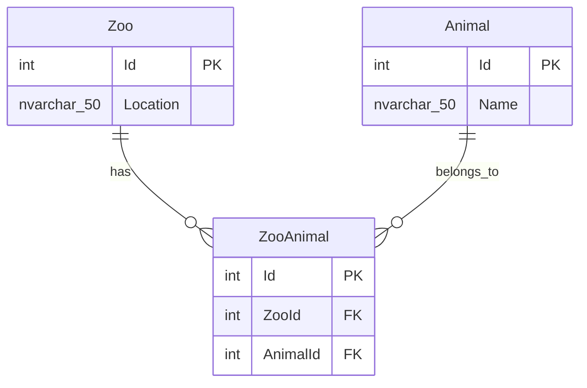

# WPF Zoo Manager

A small Windows desktop application for managing zoos, animals, and their many-to-many associations. Built with **C#**, **WPF on .NET 10**, **Entity Framework Core 10**, and **SQL Server 2025 Express LocalDB**.

## Features

### Implemented in the supplied source

- Display all zoos and all animals in separate WPF `ListBox` controls on window load, using the extracted asynchronous `LoadZoosAsync()` and `LoadAnimalsAsync()` helpers.
- Select a zoo to asynchronously load its associated animals into a third ListBox, using the `ZooAnimal` many-to-many junction table.
- **Create a zoo** from the shared editor TextBox (`Add Zoo`).
- **Create an animal** from the shared editor TextBox (`Add Animal`).
- **Associate an existing animal with a zoo** (`Add Animal to Zoo`), with a duplicate check and a database uniqueness constraint.
- **Remove an animal from a selected zoo** (`Remove Animal`) by deleting only its `ZooAnimal` association; the animal remains available in the global animal list and in any other zoos.
- **Delete a zoo** (`Delete Zoo`) after confirmation; SQL Server cascades deletion of junction-table associations.
- **Delete an animal** (`Delete Animal`) after confirmation; SQL Server cascades deletion of its associations across all zoos.
- **Rename a zoo** (`Update Zoo`) and **rename an animal** (`Update Animal`) using EF Core `ExecuteUpdateAsync()`.
- Copy the currently selected zoo location or animal name into a **shared editing TextBox**. The last active list determines whether the user is editing a zoo or an animal, including when choosing an animal from either animal list.
- Enable only the corresponding **Update Zoo** or **Update Animal** button for the current editing selection.
- Refresh list contents after creates/deletes; synchronize displayed animal names across the two animal lists after an update.
- Reuse extracted asynchronous loading methods: `LoadZoosAsync()`, `LoadAnimalsAsync()`, and `LoadAssociatedAnimalsAsync(int zooId)`.
- Select newly inserted records using the SQL Server-generated identity: `SelectedValuePath="Id"` in XAML and `SelectedValue = entity.Id` after reloading the corresponding list.
- Use asynchronous EF Core queries and writes, `AsNoTracking()` for read-only lists, and a shared immutable `DbContextOptions<ZooContext>` configuration.

### Not yet implemented / planned

- MVVM / declarative `ItemsSource` and `SelectedItem` bindings with ViewModel commands. The current app uses WPF code-behind event handlers.
- Consistent sorting and selection preservation after renaming or reloading list contents.

### Current UI behavior

| Control | Purpose |
| --- | --- |
| **Zoos** (`ZooListBox`) | Selects a zoo; selection loads its associated animals |
| **Associated Animals** (`AssociatedAnimalsListBox`) | Shows animals assigned to the selected zoo; can be used as an animal editing source |
| **Animals** (`AnimalsListBox`) | Lists all animals; supplies the animal selected for association or deletion |
| **Shared editor** (`MyTextBox`) | Accepts new zoo locations / animal names and edits the last activated item |
| **Add Animal to Zoo** | Creates the association for the selected zoo and globally selected animal |
| **Remove Animal** | Removes the selected associated animal from the currently selected zoo only |
| **Update Zoo** | Enabled when the active editing item is a zoo |
| **Update Animal** | Enabled when the active editing item is an animal from either animal list |

> **Important distinction:** **Delete Animal** deletes the animal entity globally (and cascades its associations). **Remove Animal** deletes only the matching `ZooAnimal` association, leaving the animal available elsewhere.

## Technology stack

| Component | Technology |
| --- | --- |
| Language | C# |
| Desktop UI | WPF (Windows Presentation Foundation) |
| Runtime | .NET 10 (`net10.0-windows`) |
| ORM | Entity Framework Core 10 |
| Database provider | `Microsoft.EntityFrameworkCore.SqlServer` |
| Database engine | SQL Server 2025 Express LocalDB |
| Database access | LINQ, asynchronous EF Core queries |

## Database model

Zoos and animals have a **many-to-many relationship**, represented by an explicit `ZooAnimal` junction table.



Key constraints:

- All three tables use `INT IDENTITY(1,1)` primary keys.
- `Zoo.Location` is required and limited to 50 characters.
- `Animal.Name` is nullable and limited to 50 characters.
- `(ZooId, AnimalId)` is unique, preventing duplicate associations.
- Both foreign keys in `ZooAnimal` use **`ON DELETE CASCADE`**. Deleting a zoo or an animal removes its associations, **not** the records on the other side of the relationship.

### Schema for a fresh database

The following script is for **new installations only**. If you already have the `LocalDB` database and these tables, **do not rerun it**.

```sql
CREATE DATABASE [LocalDB];
GO
USE [LocalDB];
GO

CREATE TABLE [dbo].[Zoo] (
    [Id]       INT IDENTITY (1, 1) NOT NULL,
    [Location] NVARCHAR(50) NOT NULL,
    PRIMARY KEY CLUSTERED ([Id] ASC)
);

CREATE TABLE [dbo].[Animal] (
    [Id]   INT IDENTITY (1, 1) NOT NULL,
    [Name] NVARCHAR(50) NULL,
    PRIMARY KEY CLUSTERED ([Id] ASC)
);

CREATE TABLE [dbo].[ZooAnimal] (
    [Id]       INT IDENTITY (1, 1) NOT NULL,
    [ZooId]    INT NOT NULL,
    [AnimalId] INT NOT NULL,
    PRIMARY KEY CLUSTERED ([Id] ASC),
    CONSTRAINT [UQ_ZooAnimal_ZooId_AnimalId]
        UNIQUE NONCLUSTERED ([ZooId] ASC, [AnimalId] ASC),
    CONSTRAINT [AnimalFK]
        FOREIGN KEY ([AnimalId]) REFERENCES [dbo].[Animal] ([Id])
        ON DELETE CASCADE,
    CONSTRAINT [ZooFK]
        FOREIGN KEY ([ZooId]) REFERENCES [dbo].[Zoo] ([Id])
        ON DELETE CASCADE
);
```

## Getting started

### Requirements

- Windows with the **.NET 10 SDK** and WPF support.
- SQL Server **LocalDB** (SQL Server 2025 Express LocalDB was used during development), or a SQL Server instance with an equivalent database schema.
- Visual Studio with .NET desktop development support is recommended.

### 1. Check the LocalDB instance

In PowerShell:

```powershell
sqllocaldb info
sqllocaldb info MSSQLLocalDB
```

If the instance is installed but stopped:

```powershell
sqllocaldb start MSSQLLocalDB
```

Create the database using the schema above **only if it does not already exist**. You can inspect it with SQL Server Management Studio or `sqlcmd`.

> **Instance vs. database:** `(localdb)\MSSQLLocalDB` is the SQL Server **instance**; `LocalDB` is the **database name** in that instance. They are not the same thing as the separate full SQL Server default instance (`MSSQLSERVER`).

### 2. Configure the connection

The supplied application's `MainWindow.xaml.cs` currently defines one reusable `DbContextOptions<ZooContext>` field using this local-development connection string:

```csharp
private static readonly DbContextOptions<ZooContext> DbOptions =
    new DbContextOptionsBuilder<ZooContext>()
        .UseSqlServer(
            "Server=(localdb)\\MSSQLLocalDB;" +
            "Database=LocalDB;" +
            "Integrated Security=True;" +
            "TrustServerCertificate=True;")
        .Options;
```

Handlers construct a fresh `ZooContext(DbOptions)` for each operation. Update the server and database values if you use a different SQL Server installation. `TrustServerCertificate=True` is suitable for a local development setup, not a replacement for proper certificate validation in production.

### 3. Restore, build, and run

From the folder containing the project `.csproj` file:

```powershell
dotnet restore
dotnet build
dotnet run
```

The project requires the EF Core SQL Server package. In the supplied setup, the package version was **10.0.12**:

```powershell
dotnet add package Microsoft.EntityFrameworkCore.SqlServer --version 10.0.12
```

Run the installation command only if the package reference is missing from your project.

## Working with EF Core

The database was approached using **Database First** (reverse engineering). Its generated context exposes:

```csharp
public virtual DbSet<Zoo> Zoos { get; set; }
public virtual DbSet<Animal> Animals { get; set; }
public virtual DbSet<ZooAnimal> ZooAnimals { get; set; }
```

For example, loading the animals associated with a selected zoo:

```csharp
var animals = await db.Animals
    .AsNoTracking()
    .Where(animal => db.ZooAnimals.Any(link =>
        link.ZooId == selectedZoo.Id &&
        link.AnimalId == animal.Id))
    .OrderBy(animal => animal.Name)
    .ToListAsync();
```

The window currently uses three loading helpers to avoid repeating read queries across CRUD handlers:

```csharp
Task LoadZoosAsync();
Task LoadAnimalsAsync();
Task LoadAssociatedAnimalsAsync(int zooId);
```

The associated-animals helper verifies that the requested zoo is still selected before assigning results to the UI. The initial window load now reuses the same helpers:

```csharp
await LoadZoosAsync();
await LoadAnimalsAsync();
```

To regenerate EF Core entity classes **from the existing schema**, install the design-time tools if necessary:

```powershell
dotnet add package Microsoft.EntityFrameworkCore.Design --version 10.0.12
dotnet tool install --global dotnet-ef --version 10.0.12
```

If `dotnet-ef` is already installed, use `dotnet tool update --global dotnet-ef --version 10.0.12` instead.

Then scaffold:

```powershell
dotnet ef dbcontext scaffold `
    'Server=(localdb)\MSSQLLocalDB;Database=LocalDB;Integrated Security=True;TrustServerCertificate=True;' `
    Microsoft.EntityFrameworkCore.SqlServer `
    --context ZooContext `
    --context-dir Data `
    --output-dir Models `
    --no-onconfiguring
```

Use `--force` only when you intentionally want to overwrite generated source files; first commit any changes to version control. Scaffolding reads the database schema and generates C# code; it does not recreate the tables.

## Project structure

```text
WPF Zoo Manager/
├── App.xaml                  # Application entry point
├── App.xaml.cs
├── MainWindow.xaml           # WPF window, lists, editor, buttons
├── MainWindow.xaml.cs        # UI events and EF Core operations
├── Data/
│   └── ZooContext.cs        # EF Core database context
└── Models/
    ├── Zoo.cs                # Zoo entity
    ├── Animal.cs             # Animal entity
    └── ZooAnimal.cs          # Explicit many-to-many association
```

## Implementation notes and limitations

- The UI is currently built with **WPF code-behind** and explicitly assigned `ItemsSource` collections. It does not yet use MVVM or `ICommand` bindings.
- The `ZooListBox_SelectionChanged` handler reloads related animals; common selection/focus handlers populate `MyTextBox` and enable the appropriate update button.
- Updates use `ExecuteUpdateAsync()` and mutate the currently displayed entity objects to refresh their text. `Items.Refresh()` **does not automatically re-sort** a list after a rename.
- `Add Zoo` and `Add Animal` reload their lists and select the newly inserted row by its generated `Id`; they no longer explicitly clear the shared editing TextBox.
- `Remove Animal` uses `ExecuteDeleteAsync()` on `ZooAnimal`, not on `Animal`, and refreshes the associated-animals list.
- Replacing `ItemsSource` can clear selections and invalidate stored references to objects from a previous list load; later refactoring could restore selection by ID consistently.
- The associated-animals helper guards against results for a *different currently selected zoo*, but doesn't cancel obsolete queries; rapid changes (A → B → A) can still result in older data being displayed.
- EF Core `DbContext` instances are not thread-safe; this code creates a separate context for each operation while reusing immutable options.
- `ExecuteDeleteAsync()` and `ExecuteUpdateAsync()` execute SQL immediately; they don't need `SaveChangesAsync()`. `Add()` requires `SaveChangesAsync()` to persist inserted entities.
- The current app handles common duplicate relationships (`ZooAnimal`) and validates names/locations to 1–50 characters in the UI; it is still a **learning/demo project**, not a hardened production application.
- `.gitignore` excludes build artifacts, Visual Studio local state, NuGet packages and logs.

## Next steps

1. Standardize list refreshes so the currently selected entity and editing state are preserved by primary key where appropriate.
2. Preserve alphabetical sorting after rename operations, and address stale asynchronous requests using cancellation or request versioning.
3. Consider MVVM with `CommunityToolkit.Mvvm`, typed commands, and observable properties for declarative selection and button enabling.
4. Add database integration tests and stronger error handling for concurrent operations.
